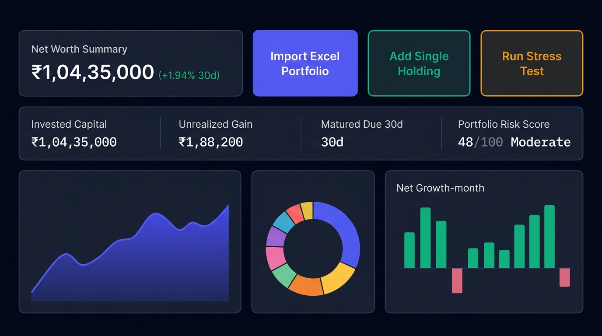
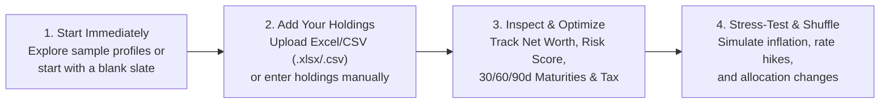
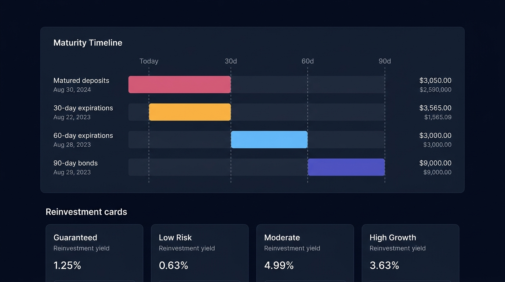

# Vestora — Personal Wealth Tracker & Portfolio Simulator

**Vestora** brings all your investments into one clear workspace—helping you catch idle matured deposits, audit tax-saving opportunities, gauge portfolio risk, and stress-test your net worth against economic shocks—without creating an account or sending your data to any server.

**Live App:** [https://vestorawealths.app](https://vestorawealths.app)

---

## How It Works

---

## What Vestora Helps You Do

### 1. Track & Understand Your Full Portfolio
- **Unified Multi-Asset View**: Consolidate Mutual Funds, Direct Stocks, Fixed Deposits (FD), Recurring Deposits (RD), Sovereign Gold Bonds (SGB), Corporate & Government Bonds, EPF, PPF, NPS, and Savings Cash in one place.
- **Multi-Currency Support**: View and normalize holdings across **INR (₹)**, **USD ($)**, and **EUR (€)** with live benchmark exchange rates.
- **Net Worth Summary & Risk Posture**: See your total portfolio value, 30-day change, unrealized gains, and an automatic **Portfolio Risk Score (1–100)** classifying your mix from *Conservative* to *Aggressive*.
- **Interactive Charts**:
  - **Portfolio Value Trend** across 3M, 6M, and 12M horizons.
  - **Month-over-Month Net Growth** bar chart highlighting expansion months vs. pullbacks.
  - **Asset Allocation** breakdown by individual category or broad asset class.
- **Smart Alerts**: Flags matured or soon-to-mature deposits as well as holdings that gained **more than 15% in the last 30 days**.

### 2. Simulate Your Own Portfolio in Seconds
Start by exploring built-in sample investor profiles, then switch to your real numbers whenever you are ready:
- **Import Excel or Statements**: Upload `.xlsx`, `.xls`, `.csv`, CAS, or MF Central exports — or download a ready-made `.xlsx` template, preview parsed rows, and either start fresh or add to your existing holdings.
- **Manual & Batch Entry**: Add a single holding quickly or enter multiple rows at once in a fast table builder.
- **Live NAV Sync**: Refresh mutual fund valuations from public AMFI NAV feeds in one click.

### 3. Eliminate Idle Cash with Maturity Radar

- **Maturity Timeline**: Visual horizon bar chart tracking upcoming expiration dates across **30, 60, and 90-day** windows.
- **Reinvestment Engine**: Select any matured or maturing deposit/bond and compare curated alternatives across **Guaranteed**, **Low**, **Moderate**, and **High Growth** risk tiers with estimated annual yields and tax treatment.

### 4. Audit Tax Efficiency & Concentration Risk
- **Tax-Gain Harvesting**: Spot unrealized equity gains eligible for annual LTCG exemption resets.
- **Deduction Tracking**: Check remaining headroom under **Section 80C** and **Section 80CCD(1B) (NPS)**.
- **Concentration Warnings**: Detect when a single holding or asset class makes up too large a share of your net worth.

### 5. Stress-Test Market & Economic Scenarios
- **Macro Stress Lab**: Adjust **Inflation**, **Interest Rate Changes**, **Geopolitical Risk**, **Equity Market Shocks**, and **Time Horizon** to see how your wealth compounds in nominal and inflation-adjusted terms.
- **Allocation Shuffler**: Shuffle your target asset mix automatically based on your chosen economic inputs—or fine-tune sliders manually—to compare resilient strategies side-by-side.

---

## At a Glance

| Workspace Tab | What You Can Do |
| :--- | :--- |
| **Overview** | Check Net Worth & 30-day change, Portfolio Risk Score (1–100), Value Trend, MoM Net Growth, Asset Allocation, >15% 30-day gainer alerts, and quick-start Excel/manual triggers |
| **Maturity Radar** | Inspect 30 / 60 / 90-day expirations on the Maturity Timeline and compare curated reinvestment options across 4 risk tiers |
| **Tax & Insights** | Audit LTCG tax-harvesting potential, Section 80C / 80CCD(1B) shortfalls, and single-asset concentration alerts |
| **Macro Stress Lab** | Model inflation, interest rate shifts, geopolitical shocks, equity drawdowns, and shuffle portfolio allocations dynamically |

---

## Privacy & Control

- **We don't store your data with us**: There are no accounts, no sign-ups, and no external servers saving your financial records. Your spreadsheets and entries stay privately on your device.
- **Easy Export & Reset**: Download a portable backup of your portfolio anytime, or wipe and restart your simulation in one click.

---

> **Disclaimer:** Vestora is a personal portfolio tracking and scenario-simulation tool. All yields, risk scores, tax estimates, and projections are illustrative and for informational purposes only. Nothing in this application constitutes financial, investment, tax, or legal advice.
